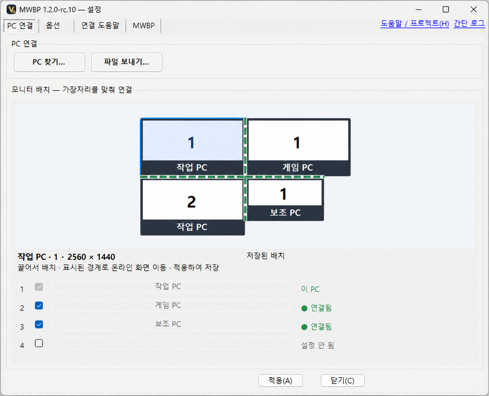

<p align="center"></p>

<h1 align="center">VEIL · MWBP</h1>
<p align="center"><strong>PC는 여러 대. 마우스는 하나.</strong><br>키보드·클립보드·파일도 함께.</p>

<p align="center">
  <a href="https://github.com/ttaem00/CVA-VEIL-Mouse_Without_Border_Plus/releases/download/mwb-v1.2.0-rc.10/VEIL-MWBP-Setup.exe"><strong>Windows x64 다운로드 ↓</strong></a>
  &nbsp;·&nbsp; <a href="https://ttaem00.github.io/CVA-VEIL-Mouse_Without_Border_Plus/">소개 페이지 ↗</a>
</p>
<p align="center"><a href="https://github.com/ttaem00/CVA-VEIL-Mouse_Without_Border_Plus/releases/tag/mwb-v1.2.0-rc.10">1.2.0-rc.10 · 미서명 배포 후보</a> · Windows 11 x64에서 확인</p>

## 시작하기

1. **설치** — 각 PC에서 설치 EXE 실행 → **MWBP 설치** → Windows 승인.
2. **연결** — **PC 찾기**에서 양쪽 확인 코드가 같으면 양쪽에서 승인.
3. **배치** — 모니터를 실제 위치에 맞춰 끌어 붙이고 **적용**.

업데이트해도 기존 연결·모니터 배치·단축키·전송 기록은 유지됩니다.

<p align="center"><a href="docs/assets/mwbp-settings-anonymized.png"></a></p>
<p align="center"><sub>실사용 화면 기반 · PC 이름 익명화 및 이미지 보정 · 눌러서 크게 보기</sub></p>

## 화면도, 키도, 파일도.

- **화면은 자유롭게.** 모니터별 배치, 스냅과 이동 가능한 접경 표시.
- **전환은 내 손에 맞게.** Caps Lock부터 여러 키 조합까지 직접 지정.
- **파일은 필요한 PC로.** 클립보드 공유, 받는 PC를 고르는 파일 보내기, 중단된 전송 재개.

[도움말](https://ttaem00.github.io/CVA-VEIL-Mouse_Without_Border_Plus/#help) · [문제 제보](https://github.com/ttaem00/CVA-VEIL-Mouse_Without_Border_Plus/issues)

<details>
<summary><strong>권한·지원 안내</strong></summary>

- **미서명 배포 후보:** Windows 승인 창에 게시자가 ‘알 수 없음’으로 표시될 수 있습니다. [릴리스의 파일 출처와 SHA256](https://github.com/ttaem00/CVA-VEIL-Mouse_Without_Border_Plus/releases/tag/mwb-v1.2.0-rc.10)을 확인하세요. Windows 11 x64에서 확인했으며, ARM64 실사용과 모든 PC 구성의 동작은 확인하지 않았습니다.
- **관리자 화면 제어:** Windows 승인을 받아 SYSTEM 입력 서비스를 설치합니다. 연결된 PC에 관리자 화면의 입력 능력을 위임하며, 이 Windows 계정의 다른 앱이 권한을 악용할 수 있습니다. 정책으로 서비스가 금지돼도 일반 입력·연결·파일 공유는 별도로 사용할 수 있습니다.
- **PC가 보이지 않을 때:** 두 PC에서 MWBP를 실행하고 네트워크 접근 허용을 확인하세요. **PC 찾기**에 상대 PC 이름이나 IPv4 주소를 직접 입력할 수도 있습니다. 양쪽 확인 코드 비교와 승인은 동일합니다.
- **파일 자동 전송:** 기본으로 켜진 **자동 전송 300MB 제한**은 클립보드로 복사한 단일 파일에 적용하며, 정확히 300MB는 허용합니다. 큰 파일은 **파일 보내기…** 또는 드래그로 전송하세요. 파일 전송 허용은 별도 설정이며, 양쪽 PC에 같은 버전을 설치하세요.
- **입력 복구:** **마우스 입력 복구**는 이 PC의 대체 커서를 끄고 입력 훅·연결을 다시 시작하도록 요청합니다. 공유가 잠시 끊기며 설정은 유지됩니다. Windows 마우스 키·숫자패드 설정은 바꾸지 않습니다. 별도 **Windows 커서 사용**은 마우스 키를 켜므로 숫자 키패드 동작에 영향을 줄 수 있습니다. 특정 지연의 해결을 보증하지 않으며, ChatGPT 실행 중 지연의 원인과 지속적인 해소는 아직 확인하지 않았습니다.
- **실행·제거:** 바탕화면이나 시작 메뉴에서 **VEIL MWBP**를 찾으세요. 새 설치는 로그인 시 자동 시작이 기본이며 업데이트는 기존 선택을 유지합니다. Windows **설치된 앱** 또는 앱 설정에서 제거하고, 연결·설정 보존 여부를 선택할 수 있습니다.
- **설치 구성:** PowerToys나 .NET을 별도로 설치할 필요가 없습니다. EXE에 .NET 10·Windows Desktop 런타임이 포함됩니다. 버전은 앱 설정 창 제목과 **정보**에서 확인하세요.

</details>

<details>
<summary><strong>개발·빌드 안내</strong></summary>

Windows · PowerShell 7 · .NET SDK **10.0.403** (`global.json` 고정).

```powershell
pwsh -NoProfile -File ./build.ps1 -RunTests
pwsh -NoProfile -File './VEIL- MWBP/Build-Release.ps1' -Destination 'C:/build/VEIL- MWBP'
```

[배포 안내](<VEIL- MWBP/README.md>) · [정적 사이트 유지보수](docs/README.md)

출력 폴더는 비어 있어야 합니다. 단일 설치 EXE·SHA256·라이선스·설치 안내를 생성하며 내부 이름과 저장 경로는 기존 MWBP와 호환되게 유지합니다. 사용자는 SDK나 비공개 저장소 접근이 필요하지 않습니다.

자동 시험 통과와 실제 세 PC 사용 확인은 구분합니다. Windows 화면 합성 시험은 시험 창이 전경을 확보하지 못하면 `Inconclusive`로 남습니다. 버전별 변경·검증 범위는 [릴리스](https://github.com/ttaem00/CVA-VEIL-Mouse_Without_Border_Plus/releases/tag/mwb-v1.2.0-rc.10)를 확인하세요. 공개 소스에 실제 사용자 설정·보안 키·전송 기록·개인 PC 진단 자료를 포함하지 않습니다.

</details>

## 출처와 라이선스

Microsoft PowerToys의 Mouse Without Borders를 기반으로 수정한 **비공식 프로젝트**입니다. Microsoft와 제휴하거나 보증받은 제품이 아닙니다.

MIT [aeae1/MouseWithoutBorders-Portable](https://github.com/aeae1/MouseWithoutBorders-Portable)의 `e9feba6da37b35a763a638a7e071c7189180cc14`를 기반으로 합니다. [LICENSE](LICENSE) · [NOTICE](NOTICE.md) · [제3자 고지](<VEIL- MWBP/THIRD-PARTY-NOTICES.txt>)와 원본 저작권을 보존합니다. Input Director는 공개 UX 자료만 참고했으며 독점 코드를 사용하지 않았습니다.

VEIL의 V와 MWBP 마우스 표식은 앱·설치 파일·소개 페이지에서 함께 사용합니다. [브랜드 벡터 원본](docs/assets/veil-mwbp-color.svg) · [크기별 적용 기준](docs/README.md).
